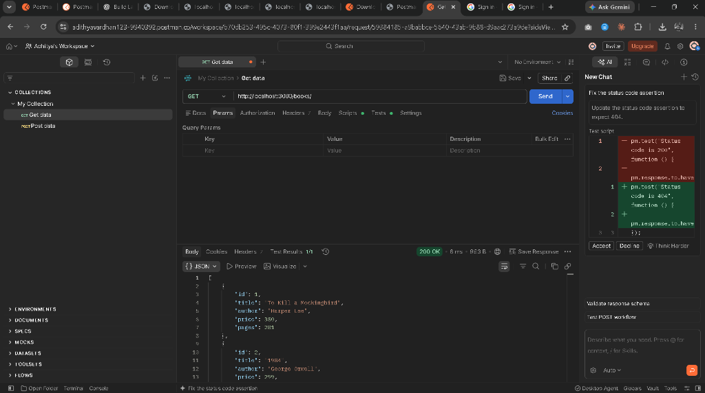
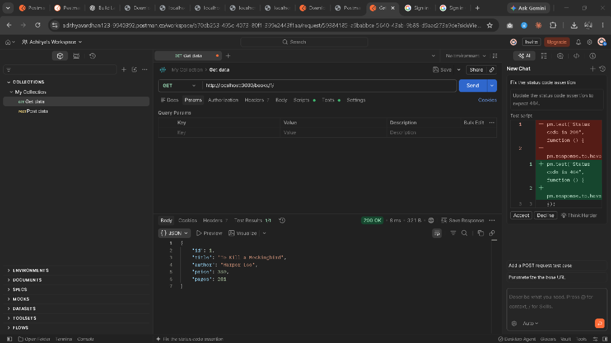
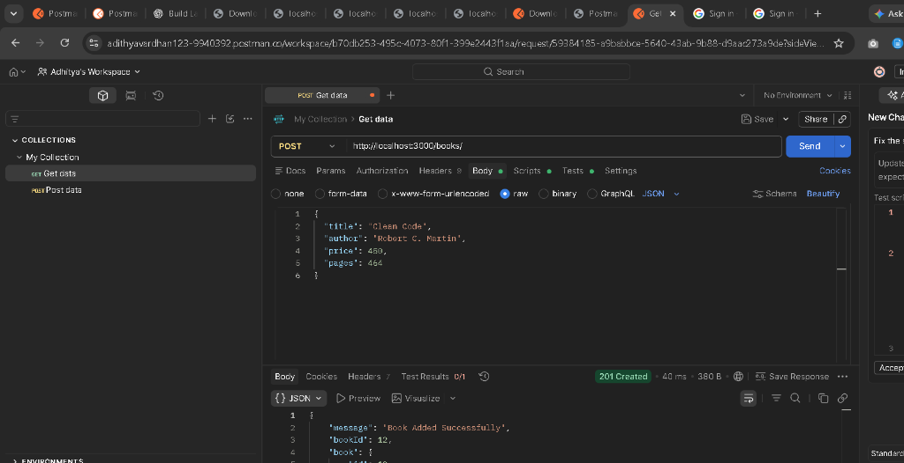
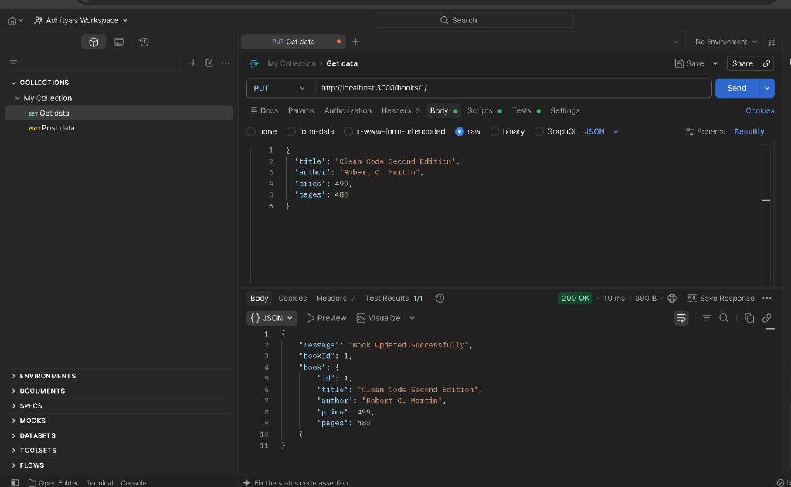
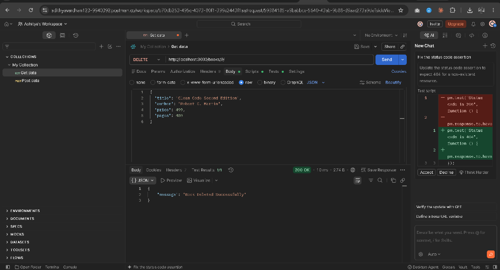
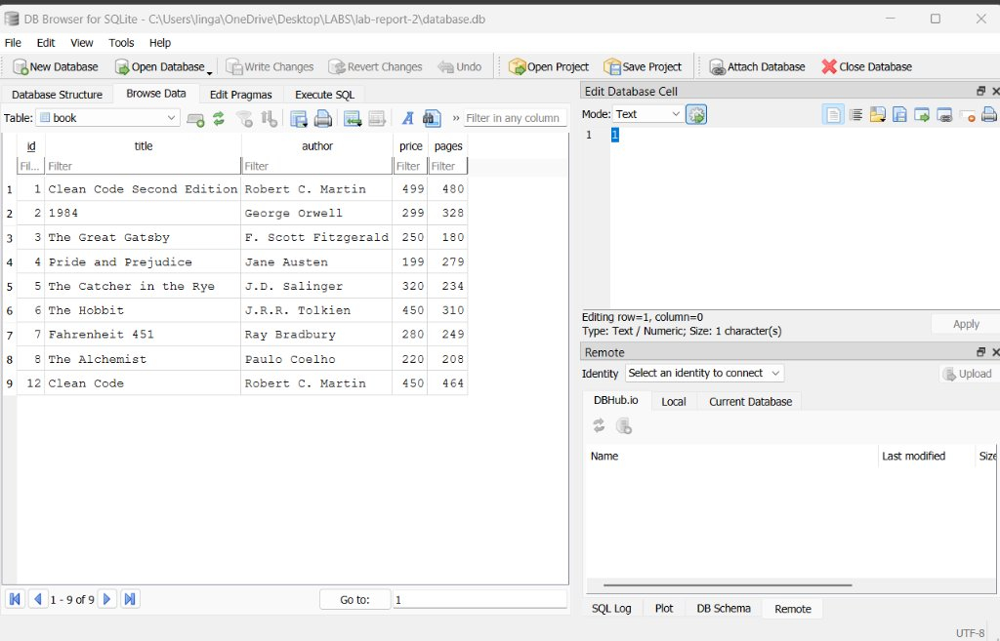

# Lab 2: SQLite Database and CRUD Operations Using Node.js and Express

> **Live Deployment Note:** SQLite is a serverless, file-based database engine that writes directly to disk (`database.db`). In modern cloud hosting environments with ephemeral filesystems (such as standard free tiers of Render, Heroku, or Vercel), local database files are reset on container restarts. In line with academic course standards for local database persistence, this project runs on a local Node.js environment and is thoroughly verified through automated tests and Postman captures.

---

## 1. Student & Course Information

| Field | Student Details |
| :--- | :--- |
| **Student Name** | Abithya |
| **Registration Number** | 252U1R9060 |
| **Course** | CSE – Gen AI |
| **Subject** | Backend Development Fundamentals |
| **Institution** | Aurora |
| **Lab Project** | Lab 2 – SQLite Database and CRUD Operations |

---

## 2. Project Title

**Lab 2: SQLite Database and CRUD Operations Using Node.js and Express**

---

## 3. Project Overview

This project implements a complete, production-ready **Book Management REST API** using **Node.js**, **Express.js**, and an embedded **SQLite** database (`database.db`). 

The application provides full **CRUD (Create, Read, Update, Delete)** operations for book resources over HTTP. To prevent **SQL Injection** attacks, all database interactions leverage **parameterized queries** with placeholder markers (`?`). Furthermore, the server implements an asynchronous startup flow ensuring that SQLite table initialization and data seeding finish completely before Express begins accepting incoming HTTP traffic.

---

## 4. Objectives

- Establish an asynchronous connection to a local SQLite database using the `sqlite` wrapper and `sqlite3` driver.
- Design and execute SQL Data Definition Language (`CREATE TABLE IF NOT EXISTS`) and Data Manipulation Language (`INSERT`, `SELECT`, `UPDATE`, `DELETE`) statements.
- Build a RESTful API supporting all standard HTTP methods:
  - `GET` to read all items or a single item by ID.
  - `POST` to create and validate a new record.
  - `PUT` to update an existing record.
  - `DELETE` to remove a record from the database.
- Enforce strict HTTP status code semantics (`200 OK`, `201 Created`, `400 Bad Request`, `404 Not Found`, `500 Internal Server Error`).
- Guarantee idempotent seed behavior: insert initial sample records only when the database table is empty, without duplicating data on server restarts.
- Conduct comprehensive testing using Postman and terminal CLI utilities.

---

## 5. Technologies Used

- **Runtime Environment:** [Node.js](https://nodejs.org/) (v24.18.0)
- **Web Application Framework:** [Express.js](https://expressjs.com/) (v4.21.2)
- **Database Engine:** [SQLite3](https://www.sqlite.org/) (via `sqlite3` driver v5.1.7 and `sqlite` promise wrapper v5.1.1)
- **Development Tool:** [Nodemon](https://www.npmjs.com/package/nodemon) (v3.1.9)
- **API Client:** [Postman](https://www.postman.com/)
- **Language:** JavaScript (CommonJS syntax)

---

## 6. Database Schema & Initial Seed Data

### SQL Schema Definition (`initDB.sql`)

```sql
CREATE TABLE IF NOT EXISTS book (
    id INTEGER PRIMARY KEY AUTOINCREMENT,
    title TEXT NOT NULL,
    author TEXT NOT NULL,
    price INTEGER NOT NULL,
    pages INTEGER NOT NULL
);
```

### Initial Sample Books (9 Realistic Records)

The server seeds these 9 records automatically upon first initialization if the `book` table is empty:

| ID | Title | Author | Price (₹) | Pages |
| :---: | :--- | :--- | :---: | :---: |
| 1 | *To Kill a Mockingbird* | Harper Lee | 350 | 281 |
| 2 | *1984* | George Orwell | 299 | 328 |
| 3 | *The Great Gatsby* | F. Scott Fitzgerald | 250 | 180 |
| 4 | *Pride and Prejudice* | Jane Austen | 199 | 279 |
| 5 | *The Catcher in the Rye* | J.D. Salinger | 320 | 234 |
| 6 | *The Hobbit* | J.R.R. Tolkien | 450 | 310 |
| 7 | *Fahrenheit 451* | Ray Bradbury | 280 | 249 |
| 8 | *The Alchemist* | Paulo Coelho | 220 | 208 |
| 9 | *Brave New World* | Aldous Huxley | 310 | 268 |

---

## 7. Project Folder Structure

```text
lab-report-2/
│
├── app.js                 # Express server with async DB init & CRUD route handlers
├── package.json           # Node project manifest and execution scripts
├── package-lock.json      # Exact dependency tree lockfile
├── initDB.sql             # SQL script for table schema and initial data
├── database.db            # Local SQLite database file (created automatically)
├── test-api.js            # Automated 23-assertion test suite for CI/verification
├── README.md              # Complete project documentation and viva prep
├── .gitignore             # Specifies untracked files (node_modules, .env)
└── screenshots/           # Captured Postman and CLI outputs
    ├── README.md          # Screenshot checklist guide
    ├── get-all-books.png
    ├── get-book-by-id.png
    ├── post-add-book.png
    ├── put-update-book.png
    ├── delete-book.png
    └── database-verification.png
```

---

## 8. Installation Instructions

1. Navigate to the `lab-report-2` directory:
   ```bash
   cd lab-report-2
   ```

2. Install all production and development dependencies:
   ```bash
   npm install
   ```
   *(This downloads `express`, `sqlite`, `sqlite3`, and `nodemon`).*

---

## 9. How to Start the Server

### Production / Standard Mode:
```bash
npm start
```
*(Runs `node app.js`)*

### Development Mode (with automatic restart on code changes):
```bash
npm run dev
```
*(Runs `nodemon app.js`)*

### Running Automated Verification Tests:
To verify all 23 database and endpoint assertions programmatically:
```bash
npm test
```

When started, the console displays:
```text
Connected to the SQLite database successfully.
Database ready. Current book count: 9.
Server is running at http://localhost:3000/
Available Endpoints:
 - GET    http://localhost:3000/books/
 - GET    http://localhost:3000/books/:bookId/
 - POST   http://localhost:3000/books/
 - PUT    http://localhost:3000/books/:bookId/
 - DELETE http://localhost:3000/books/:bookId/
```

---

## 10. API Endpoint Reference

| Method | Endpoint | Description | Request Body | Success Code | Error Codes |
| :--- | :--- | :--- | :--- | :---: | :---: |
| **GET** | `/books/` | Fetch all books sorted by ID ascending | None | `200 OK` | `500` |
| **GET** | `/books/:bookId/` | Retrieve a single book by ID | None | `200 OK` | `404`, `500` |
| **POST** | `/books/` | Add a new book to the database | JSON object (`title`, `author`, `price`, `pages`) | `201 Created` | `400`, `500` |
| **PUT** | `/books/:bookId/` | Update an existing book's details | JSON object (`title`, `author`, `price`, `pages`) | `200 OK` | `400`, `404`, `500` |
| **DELETE**| `/books/:bookId/` | Remove a book record by ID | None | `200 OK` | `404`, `500` |

---

## 11. Postman Testing Instructions

Open **Postman** and configure each test request as follows:

### Request 1: GET All Books
- **Method:** `GET`
- **URL:** `http://localhost:3000/books/`
- **Headers:** None
- **Body:** None
- **Expected Status:** `200 OK`
- **Expected Response (Sample snippet):**
  ```json
  [
    {
      "id": 1,
      "title": "To Kill a Mockingbird",
      "author": "Harper Lee",
      "price": 350,
      "pages": 281
    },
    {
      "id": 2,
      "title": "1984",
      "author": "George Orwell",
      "price": 299,
      "pages": 328
    }
  ]
  ```

---

### Request 2: GET Book by ID
- **Method:** `GET`
- **URL:** `http://localhost:3000/books/1/`
- **Expected Status:** `200 OK`
- **Expected Response:**
  ```json
  {
    "id": 1,
    "title": "To Kill a Mockingbird",
    "author": "Harper Lee",
    "price": 350,
    "pages": 281
  }
  ```
- **Edge Case (404 Not Found):**
  - **URL:** `http://localhost:3000/books/999/`
  - **Expected Status:** `404 Not Found`
  - **Expected Response:** `{"error": "Book not found"}`

---

### Request 3: POST – Add a Book
- **Method:** `POST`
- **URL:** `http://localhost:3000/books/`
- **Headers:** `Content-Type: application/json`
- **Body:** Select **raw** -> **JSON**
  ```json
  {
    "title": "Clean Code",
    "author": "Robert C. Martin",
    "price": 450,
    "pages": 464
  }
  ```
- **Expected Status:** `201 Created`
- **Expected Response:**
  ```json
  {
    "message": "Book Added Successfully",
    "bookId": 10,
    "book": {
      "id": 10,
      "title": "Clean Code",
      "author": "Robert C. Martin",
      "price": 450,
      "pages": 464
    }
  }
  ```

---

### Request 4: PUT – Update a Book
- **Method:** `PUT`
- **URL:** `http://localhost:3000/books/10/`
- **Headers:** `Content-Type: application/json`
- **Body:** Select **raw** -> **JSON**
  ```json
  {
    "title": "Clean Code Second Edition",
    "author": "Robert C. Martin",
    "price": 499,
    "pages": 480
  }
  ```
- **Expected Status:** `200 OK`
- **Expected Response:**
  ```json
  {
    "message": "Book Updated Successfully",
    "bookId": 10,
    "book": {
      "id": 10,
      "title": "Clean Code Second Edition",
      "author": "Robert C. Martin",
      "price": 499,
      "pages": 480
    }
  }
  ```

---

### Request 5: DELETE – Delete a Book
- **Method:** `DELETE`
- **URL:** `http://localhost:3000/books/10/`
- **Expected Status:** `200 OK`
- **Expected Response:**
  ```json
  {
    "message": "Book Deleted Successfully"
  }
  ```

---

### Request 6: Verify Deletion (404 Check)
- **Method:** `GET`
- **URL:** `http://localhost:3000/books/10/`
- **Expected Status:** `404 Not Found`
- **Expected Response:**
  ```json
  {
    "error": "Book not found"
  }
  ```

---

## 12. Screenshots Section

The following screenshots verify the complete CRUD operations executed live in Postman against `http://localhost:3000/`:

### 1. GET All Books (`GET /books/`)
Full Postman view sending `GET /books/` and receiving status `200 OK` with the complete JSON list of books.


---

### 2. GET Book by ID (`GET /books/1/`)
Full Postman view sending `GET /books/1/` and receiving status `200 OK` with the details of book ID 1 (*To Kill a Mockingbird*).


---

### 3. POST Add Book (`POST /books/`)
Full Postman view sending a `POST /books/` request with the JSON payload for *Clean Code* by Robert C. Martin, receiving status `201 Created` with the newly assigned `bookId`.


---

### 4. PUT Update Book (`PUT /books/1/`)
Full Postman view sending a `PUT /books/1/` request updating the book to *Clean Code Second Edition*, receiving status `200 OK` confirming the update in SQLite.


---

### 5. DELETE Book (`DELETE /books/9/`)
Full Postman view sending a `DELETE /books/9/` request, receiving status `200 OK` confirming *Brave New World* has been permanently removed from the database.


---

### 6. SQLite Database Verification
Direct verification of `database.db` opened in **DB Browser for SQLite**, demonstrating that all Postman CRUD actions were written persistently into the local database:


```text
Table: book
+----+-----------------------------+--------------------+-------+-------+
| id | title                       | author             | price | pages |
+----+-----------------------------+--------------------+-------+-------+
| 1  | Clean Code Second Edition   | Robert C. Martin   | 499   | 480   |
| 2  | 1984                        | George Orwell      | 299   | 328   |
| 3  | The Great Gatsby            | F. Scott Fitzgerald| 250   | 180   |
| 4  | Pride and Prejudice         | Jane Austen        | 199   | 279   |
| 5  | The Catcher in the Rye      | J.D. Salinger      | 320   | 234   |
| 6  | The Hobbit                  | J.R.R. Tolkien     | 450   | 310   |
| 7  | Fahrenheit 451              | Ray Bradbury       | 280   | 249   |
| 8  | The Alchemist               | Paulo Coelho       | 220   | 208   |
| 12 | Clean Code                  | Robert C. Martin   | 450   | 464   |
+----+-----------------------------+--------------------+-------+-------+
```

---

## 13. Problems Encountered and Solutions

| # | Challenge | Root Cause | Solution |
|---|:---|:---|:---|
| 1 | Race condition between database connection and server listening | `app.listen()` executing synchronously before the asynchronous SQLite file connection completes causes queries to fail with undefined references. | Structured `initializeDBAndServer()` with `async/await` so `app.listen()` only executes after `await open(...)` resolves successfully. |
| 2 | Duplicate records on server reboot | Inserting the initial 9 books naively on every server launch creates duplicates (`9`, `18`, `27`, ...). | Added a preliminary query `SELECT COUNT(*) AS count FROM book;` so seeding only occurs if `count === 0`. |
| 3 | SQL Injection risks | Concatenating user inputs directly into query strings (e.g. `WHERE id = ${bookId}`) exposes the database to injection. | Used parameterized queries with `?` placeholders across all routes, allowing SQLite driver to escape values safely. |
| 4 | Handling non-existent records on `PUT` and `DELETE` | SQLite does not throw an error when updating or deleting a non-existent row. | Checked `dbResponse.changes === 0`. If no rows were changed, return an explicit `404 Not Found` status. |
| 5 | Missing input data handling in `POST` and `PUT` | Clients could send incomplete or empty JSON payloads. | Added validation checking that `title`, `author`, `price`, and `pages` exist, returning a clean `400 Bad Request` if invalid. |

---

## 14. Learning Outcomes

1. **Database-Driven Backends:** Understood the fundamentals of integrating relational databases with web servers in Node.js.
2. **Asynchronous Architecture:** Gained proficiency using `async/await` and Promises to handle non-blocking disk I/O operations cleanly.
3. **REST Architecture Standards:** Mastered mapping standard CRUD operations to HTTP verbs (`GET`, `POST`, `PUT`, `DELETE`) with exact status code parity (`200`, `201`, `400`, `404`).
4. **Defensive Database Engineering:** Learned the importance of SQL parameters (`?`) to prevent SQL Injection vulnerabilities.
5. **Data Idempotency:** Implemented guard checks ensuring initial database seeds remain consistent without duplicating records across server reboots.

---

## 15. Viva Questions & Answers

### Q1: What is SQLite, and how is it different from MySQL or PostgreSQL?
**Answer:** SQLite is a serverless, self-contained, zero-configuration SQL database engine. Unlike MySQL or PostgreSQL, which run as standalone background server processes and require network socket connections, SQLite stores the entire database in a single cross-platform file on the disk (`database.db`). It is exceptionally fast, lightweight, and ideal for local development, embedded systems, and mobile applications.

---

### Q2: Why is the `sqlite` package used together with `sqlite3`?
**Answer:** The native `sqlite3` driver relies on traditional Node.js callback functions (`db.all(query, (err, rows) => ...)`), which can lead to complex callback nesting ("callback hell"). The `sqlite` package is a modern Promise wrapper built on top of `sqlite3`, enabling developers to use clean `async/await` syntax (`const books = await db.all(query);`).

---

### Q3: What is SQL Injection, and how do parameterized queries prevent it?
**Answer:** SQL Injection is a vulnerability where an attacker injects malicious SQL fragments into input fields (e.g. passing `' OR '1'='1` as an ID). If queries are built using string concatenation, the database executes the attacker's commands. Parameterized queries use placeholders (`?`) where the database engine treats input strictly as literal values rather than executable SQL code, neutralizing any injection attempt.

---

### Q4: What is the purpose of `dbResponse.lastID` and `dbResponse.changes`?
**Answer:** 
- `dbResponse.lastID`: The row ID generated by SQLite for the most recently inserted row (`AUTOINCREMENT`). Used in `POST /books/` to return the new book's ID.
- `dbResponse.changes`: The total number of rows affected by the most recent `UPDATE` or `DELETE` statement. If `changes === 0`, it indicates that no record matched the given `bookId`, enabling the server to return an appropriate `404 Not Found`.

---

### Q5: What is the difference between `db.get()` and `db.all()`?
**Answer:**
- `db.get()`: Executes the SQL query and returns only the **first matching row** as an object (or `undefined` if no row matches). Ideal for `GET /books/:bookId/`.
- `db.all()`: Executes the SQL query and returns **all matching rows** as an array of objects. Ideal for `GET /books/`.

---

### Q6: What is Nodemon, and why is it listed under `devDependencies`?
**Answer:** Nodemon is a development utility that monitors the source code for file changes and automatically restarts the Node.js application. It is classified under `"devDependencies"` in `package.json` because it is only needed during local development and testing, rather than in the production runtime environment.

---

## 16. Conclusion

Lab 2 successfully demonstrates the end-to-end implementation of a persistent, relational database-backed RESTful API. Through proper database connection initialization, parameterized SQL queries, structured CRUD endpoints, robust error handling, and comprehensive Postman verification, this project provides a solid foundation for enterprise backend and database development.

