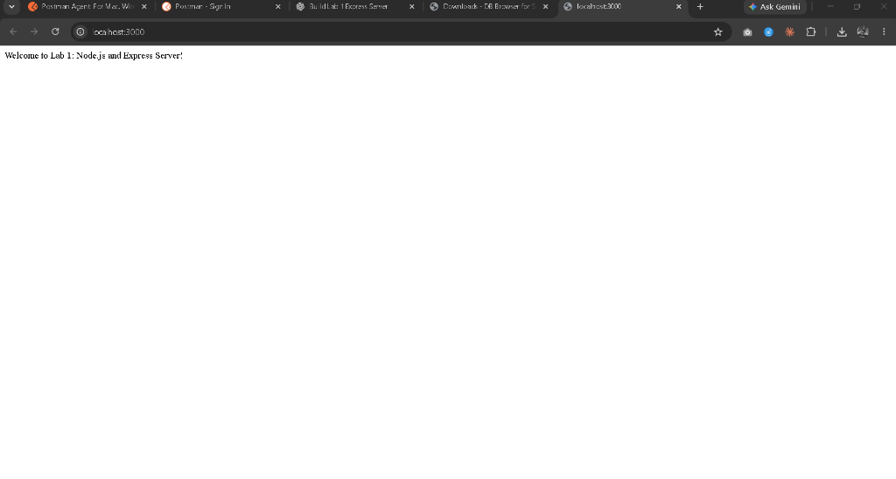
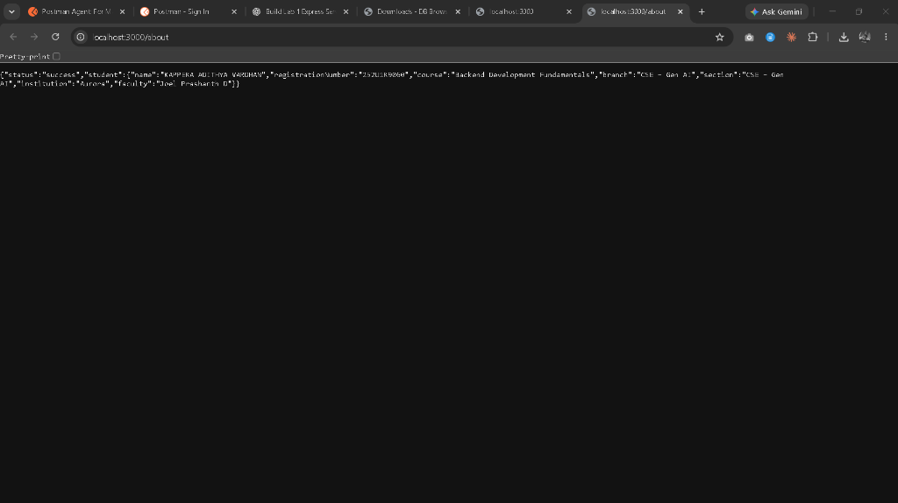
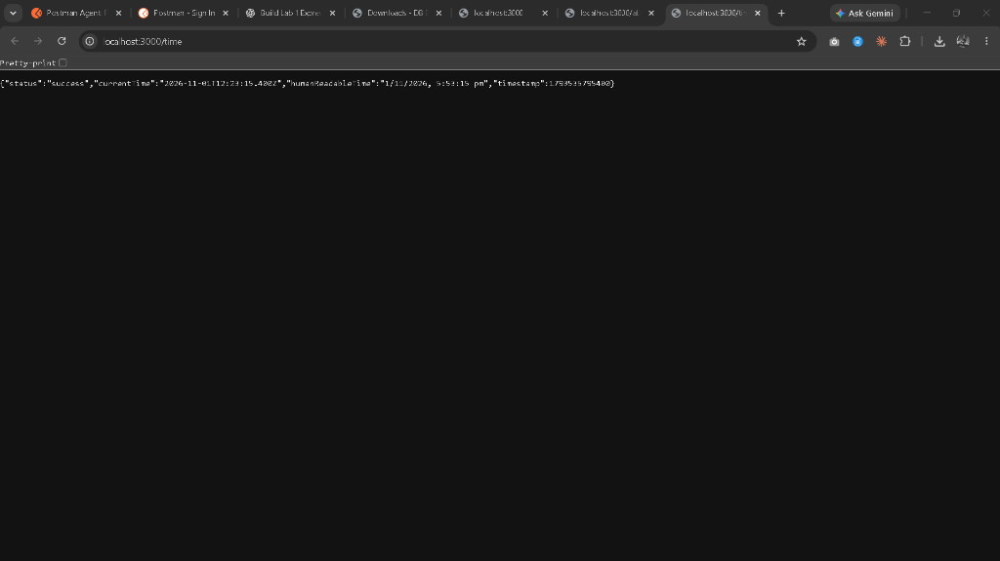
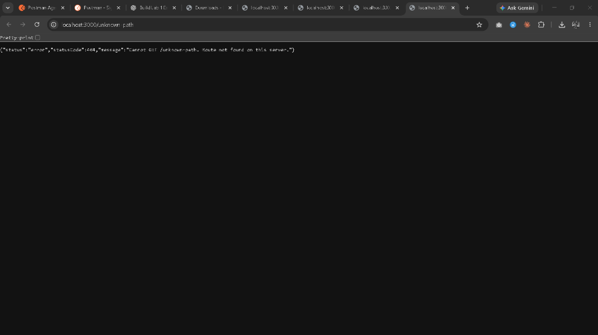

 
LINK :https://backend-lab-0l7m.onrender.com/
# Lab 1: Node.js and Express Server

> **Deployment Status:** Not deployed yet  
> *(To deploy this application to cloud platforms such as Render, Railway, or Vercel, refer to the [Deployment Guide](#how-to-deploy) below.)*

---

## 1. Student & Course Information

| Field | Details |
| :--- | :--- |
| **Student Name** | KAPPERA ADITHYA VARDHAN |
| **Registration Number** | 252U1R9060 |
| **Course** | Backend Development Fundamentals |
| **Branch** | CSE – Gen AI |
| **Section** | CSE – Gen AI |
| **Institution** | Aurora |
| **Faculty** | Joel Prashanth D |
| **Lab Assignment** | Lab 1: Node.js and Express Server |

---

## 2. Project Introduction

This project demonstrates the core concepts of server-side JavaScript development using **Node.js** and the **Express.js** framework. It showcases:
1. Building a foundational HTTP server using Node.js's built-in `http` module.
2. Creating a robust, production-grade RESTful API server using Express.js.
3. Managing HTTP status codes, structured JSON responses, environment variables for dynamic port configuration, and handling unknown routes with an intentional 404 response handler.

---

## 3. Objectives

- Understand the architecture of Node.js and how it handles asynchronous network requests.
- Initialize and configure a Node.js project using `npm`.
- Understand the role and structure of `package.json`, `package-lock.json`, and `node_modules`.
- Build a lightweight HTTP server using the native `http` module.
- Build an Express server with routing, JSON responses, and HTTP status code standards (200, 404).
- Configure environment-driven port handling (`process.env.PORT || 3000`).
- Implement defensive routing by catching unhandled routes with structured 404 responses.

---

## 4. Technologies Used

- **Runtime Environment:** [Node.js](https://nodejs.org/) (v24.18.0)
- **Package Manager:** [npm](https://www.npmjs.com/) (v11.16.0)
- **Web Framework:** [Express.js](https://expressjs.com/) (v4.21.2)
- **Built-in Modules:** `http`
- **Language:** JavaScript (CommonJS syntax)
- **Version Control:** Git & GitHub

---

## 5. Project Folder Structure

```text
lab-01/
├── app.js                 # Express server with route definitions and 404 handler
├── http-server.js         # Plain Node.js HTTP server using native 'http' module
├── package.json           # Node.js project configuration and scripts
├── package-lock.json      # Dependency lockfile ensuring reproducible builds
├── .gitignore             # Specifies intentionally untracked files (node_modules, .env)
├── test-servers.js        # Automated verification script testing all endpoints
├── README.md              # Comprehensive documentation and viva preparation
└── screenshots/           # Directory containing captured output screenshots
    ├── README.md          # Guide for saving screenshot captures
    ├── 01-welcome-page.png
    ├── 02-about-json.png
    ├── 03-time-json.png
    ├── 04-404-unknown-route.png
    └── 05-terminal-running.png
```

---

## 6. Deep Dive: Package Management Concepts

### What is `package.json`?
`package.json` is the manifest file of any Node.js project. It contains vital metadata about the application and its dependencies.

Key fields explained:
- **`name`**: The lowercase, URL-friendly unique identifier of your application or package.
- **`version`**: The semantic version (`MAJOR.MINOR.PATCH`) following semver standards (e.g., `1.0.0`).
- **`description`**: A short summary explaining what the project does.
- **`main`**: The primary entry point file of the application (e.g., `app.js`).
- **`scripts`**: A dictionary of CLI shortcuts to run tasks via `npm run <script-name>` or `npm start`.
- **`keywords`**: Array of terms that help categorize and identify the project.
- **`author`**: The creator's name and contact details.
- **`license`**: Legal license governing code usage (e.g., `ISC`, `MIT`).
- **`dependencies`**: Production libraries required at runtime (e.g., `express`).
- **`devDependencies`**: Packages only required during development and testing (e.g., test runners, nodemon).

### What is `node_modules`?
`node_modules` is the physical directory where npm downloads and extracts all installed packages and their transitive dependencies.
- It can grow quite large because packages often depend on other packages.
- **Never commit `node_modules` to Git.** It should always be excluded via `.gitignore` because it can be completely regenerated anytime by running `npm install`.

### What is `package-lock.json`?
`package-lock.json` is automatically generated whenever npm modifies `node_modules` or `package.json`.
- It records the **exact versions** and integrity hashes (SHA checksums) of every installed dependency and sub-dependency.
- It ensures that every developer and deployment platform installs the exact same dependency tree, preventing "works on my machine" bugs.
- **Always commit `package-lock.json` to Git.**

---

## 7. Installation Instructions

1. Clone or navigate to the repository directory:
   ```bash
   cd lab-01
   ```

2. Install dependencies:
   ```bash
   npm install
   ```
   *(This reads `package.json` and creates `node_modules` and `package-lock.json`.)*

---

## 8. How to Run the Plain Node.js HTTP Server

The plain HTTP server demonstrates building a web server without third-party frameworks using Node's core `http` module.

Run using npm:
```bash
npm run start:http
```
Or directly with Node:
```bash
node http-server.js
```

### Testing the Plain HTTP Server:
- Open your browser and navigate to: [http://localhost:3000](http://localhost:3000)
- Or test using cURL in a terminal:
  ```bash
  curl http://localhost:3000
  ```
- **Expected Output:**
  ```text
  Hello
  ```
- **Status Code:** `200 OK`

---

## 9. How to Run the Express Server

The Express server (`app.js`) handles structured routes, returns JSON responses, and manages unknown routes.

Run using npm:
```bash
npm start
```
*(or `npm run start:express`)*

Or directly with Node:
```bash
node app.js
```

### Running Automated Endpoint Tests:
An automated test script is provided to verify all routes and HTTP status codes:
```bash
npm test
```

---

## 10. API Endpoint Reference Table

| Method | Path | Description | Response Type | Status Code |
| :--- | :--- | :--- | :--- | :--- |
| **GET** | `/` | Welcoming root route | `text/html` / `text/plain` | `200 OK` |
| **GET** | `/about` | Returns student details and academic info | `application/json` | `200 OK` |
| **GET** | `/time` | Returns current ISO & readable server date/time | `application/json` | `200 OK` |
| **ALL** | *(any unknown)* | Catch-all handler for undefined routes | `application/json` | `404 Not Found` |

---

## 11. Request & Response Examples

### 1. Endpoint: `GET /`
- **Request:**
  ```http
  GET / HTTP/1.1
  Host: localhost:3000
  ```
- **Response:**
  ```http
  HTTP/1.1 200 OK
  Content-Type: text/html; charset=utf-8

  Welcome to Lab 1: Node.js and Express Server!
  ```

---

### 2. Endpoint: `GET /about`
- **Request:**
  ```http
  GET /about HTTP/1.1
  Host: localhost:3000
  ```
- **Response:**
  ```http
  HTTP/1.1 200 OK
  Content-Type: application/json; charset=utf-8

  {
    "status": "success",
    "student": {
      "name": "KAPPERA ADITHYA VARDHAN",
      "registrationNumber": "252U1R9060",
      "course": "Backend Development Fundamentals",
      "branch": "CSE – Gen AI",
      "section": "CSE – Gen AI",
      "institution": "Aurora",
      "faculty": "Joel Prashanth D"
    }
  }
  ```

---

### 3. Endpoint: `GET /time`
- **Request:**
  ```http
  GET /time HTTP/1.1
  Host: localhost:3000
  ```
- **Response:**
  ```http
  HTTP/1.1 200 OK
  Content-Type: application/json; charset=utf-8

  {
    "status": "success",
    "currentTime": "2026-11-01T12:09:14.129Z",
    "humanReadableTime": "1/11/2026, 5:39:14 pm",
    "timestamp": 1793534954129
  }
  ```

---

### 4. Unknown Route (404 Fallback): `GET /random-endpoint`
- **Request:**
  ```http
  GET /random-endpoint HTTP/1.1
  Host: localhost:3000
  ```
- **Response:**
  ```http
  HTTP/1.1 404 Not Found
  Content-Type: application/json; charset=utf-8

  {
    "status": "error",
    "statusCode": 404,
    "message": "Cannot GET /random-endpoint. Route not found on this server."
  }
  ```

---

## 12. Screenshots Section

The following screenshots verify the working endpoints and status codes captured from the running Express server:

### 1. `GET /` Welcome Page
Displays the initial root welcome message with status `200 OK`.


### 2. `GET /about` Student Details JSON Response
Returns the structured student credentials including name (`KAPPERA ADITHYA VARDHAN`), registration number (`252U1R9060`), course, branch, and section with status `200 OK`.


### 3. `GET /time` Current Date & Time JSON Response
Returns the real-time server timestamps (`currentTime`, `humanReadableTime`, and epoch `timestamp`) generated dynamically using `new Date()` with status `200 OK`.


### 4. 404 Unknown Route Error Response
Demonstrates defensive routing: requests to undefined endpoints (e.g. `/unknown-path`) receive a clean JSON error response with status `404 Not Found`.


### 5. Server Running in Terminal
Terminal execution log demonstrating successful server startup:
```text
> lab-01@1.0.0 start
> node app.js

[Express Server] Server running successfully on http://localhost:3000
Available Endpoints:
 - GET  http://localhost:3000/
 - GET  http://localhost:3000/about
 - GET  http://localhost:3000/time
Press Ctrl+C to terminate.
```
*(Place your terminal window screenshot in `screenshots/05-terminal-running.png` if capturing manually).*

---

## 13. Problems Faced & Solutions

| # | Problem Encountered | Cause | Solution / Fix |
|---|:---|:---|:---|
| 1 | Hardcoded port `3000` failed on cloud deployment | Production hosting services assign dynamic ports via environment variables. | Implemented `process.env.PORT \|\| 3000` so the server dynamically binds to the host's assigned port while defaulting to 3000 locally. |
| 2 | Default 404 responses in Express returned HTML instead of JSON | When an endpoint does not exist, standard Express returns an HTML error page. | Added a catch-all middleware (`app.use((req, res) => {...})`) at the end of the route chain to return a structured JSON response with status 404. |
| 3 | Accidentally tracking `node_modules` in version control | `node_modules` contains thousands of files and takes significant repository space. | Configured `.gitignore` with `node_modules/` before staging any git commits. |
| 4 | ISO time vs local time confusion | `new Date().toISOString()` returns UTC time, which differs from local system time. | Provided both `toISOString()` for standard ISO formatting and `toLocaleString()` for human-readable local time in the response. |

---

## 14. Learning Outcomes

By completing this lab, I have learned:
1. **Node.js Core Architecture:** How the asynchronous, event-driven, single-threaded event loop processes incoming HTTP requests efficiently.
2. **HTTP vs Express:** The difference between low-level stream handling in the native `http` module and the clean abstractions, routing, and middleware provided by Express.
3. **REST API Best Practices:** Designing standard endpoints, setting appropriate HTTP status codes (200 OK, 404 Not Found), and delivering clean JSON payloads.
4. **Environment Variables:** Utilizing `process.env` to ensure cross-platform compatibility across local development and production cloud environments.
5. **Defensive Programming:** Handling undefined routes systematically so the API never fails silently or returns unformatted errors.

---

## 15. Viva Questions & Answers

### Q1: What is Node.js, and why is it called single-threaded?
**Answer:** Node.js is an open-source, cross-platform JavaScript runtime environment built on Google Chrome's V8 engine. It executes JavaScript code outside a web browser. It is called single-threaded because its main JavaScript execution runs on a single thread using an **Event Loop**. Heavy I/O operations (such as file reading and network queries) are delegated to background worker threads via `libuv`, allowing the main thread to remain non-blocking.

---

### Q2: What is Express.js, and why use it over the native `http` module?
**Answer:** Express.js is a minimalist and flexible web application framework for Node.js. While the native `http` module requires manual URL parsing, header configuration, and stream handling, Express simplifies development by offering:
- Clean, intuitive route definition (`app.get()`, `app.post()`).
- Middleware architecture for request processing, authentication, and error handling.
- Built-in helpers for sending JSON responses (`res.json()`) and setting HTTP status codes (`res.status()`).

---

### Q3: What is the significance of `process.env.PORT || 3000`?
**Answer:** In local development, we typically test on a fixed port like `3000`. However, cloud deployment platforms (such as Render, Heroku, or AWS) allocate an arbitrary port dynamically at runtime through the environment variable `PORT`. Using `process.env.PORT || 3000` ensures our application gracefully accepts the cloud platform's assigned port when present, and safely falls back to `3000` on a local machine.

---

### Q4: What is the difference between `npm install` and `npm install --save-dev`?
**Answer:**
- `npm install <package>` installs dependencies required for the application to function in production (stored in the `"dependencies"` field in `package.json`, e.g., `express`).
- `npm install --save-dev <package>` installs dependencies only required during development and testing (stored in `"devDependencies"`, e.g., `nodemon`, `jest`, `eslint`), which are omitted in production builds to reduce bundle size.

---

### Q5: What is the Request-Response cycle in Express?
**Answer:** The Request-Response cycle represents the complete lifecycle of an HTTP request:
1. A client (browser, mobile app, or cURL) sends an HTTP request to the server.
2. The Express server receives the request object (`req`) and passes it sequentially through matching middleware functions.
3. A route handler processes the request, performs any necessary logic, and terminates the cycle by sending a response object (`res`) back to the client (e.g., `res.send()`, `res.json()`).
4. If no route or middleware sends a response, the cycle hangs unless caught by a 404 handler.

---

### Q6: What are HTTP Status Codes, and why are 200 and 404 used here?
**Answer:** HTTP status codes are standardized 3-digit numbers returned by a server to communicate the result of an HTTP request:
- **200 (OK):** The request has succeeded. Used when `/`, `/about`, and `/time` endpoints are accessed successfully.
- **404 (Not Found):** The server could not find the requested resource. Used when a client requests an undefined route.

---

### Q7: Why must `node_modules` be added to `.gitignore`?
**Answer:**
1. **Size:** The `node_modules` folder contains thousands of nested files and can weigh hundreds of megabytes.
2. **Platform Dependency:** Some native binary packages build differently on Windows, macOS, or Linux.
3. **Reproducibility:** `package.json` and `package-lock.json` record the exact dependency list. Anyone can easily recreate `node_modules` locally with `npm install`.

---

<a id="how-to-deploy"></a>
## 16. How to Deploy (Step-by-Step Guide)

When ready to deploy your application to a free cloud hosting provider such as **Render**:

1. **Push your code to GitHub:**
   ```bash
   git add .
   git commit -m "Complete Lab 1: Node.js and Express Server"
   git push origin main
   ```
2. **Create a Free Account on [Render.com](https://render.com/)**.
3. **Create a New Web Service:**
   - Connect your GitHub repository.
   - Set **Root Directory** to: `lab-01`
   - Set **Runtime** to: `Node`
   - Set **Build Command** to: `npm install`
   - Set **Start Command** to: `npm start`
4. **Deploy:** Click **Deploy Web Service**.
5. Once deployment succeeds, copy your live URL (e.g., `https://lab-01-adithya.onrender.com`) and update the **Deployment Status** at the top of this README.

---

## 17. Conclusion

Lab 1 successfully establishes a clear understanding of:
- Project initialization and dependency management in Node.js.
- Differences between low-level HTTP servers and the Express framework.
- Structuring RESTful API endpoints with appropriate HTTP status codes and JSON formatting.
- Configuring applications for cloud deployment and writing comprehensive technical documentation.

